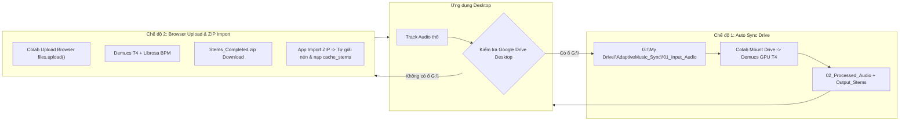

# Desktop Audio & AI Engineering: Architecture, Dependency Audit & Deployment Guide

> [!IMPORTANT]
> **Triết lý Cốt lõi (The Zero-Assumption Principle)**:
> *"Dùng phụ thuộc bên thứ 3 không xấu, nhưng dùng phụ thuộc xong lại xem phụ thuộc đó là mặc định có sẵn ở mọi máy người dùng mới là điều tối kỵ."*
> 
> Máy tính của lập trình viên (Developer Machine) luôn tích lũy sẵn vô số công cụ, PATH, thư viện C++, codec, driver... qua nhiều năm. Máy người dùng (Clean User Environment) hoàn toàn là một "hộp đen". Mọi giả định về môi trường người dùng nếu không được kiểm định đều sẽ dẫn đến crash hoặc lỗi không mong muốn.

---

## 1. Module 0: Quy trình Audit Phụ thuộc Trước Khi Đóng Gói (Pre-Release Audit)

Trước khi kích hoạt lệnh build (PyInstaller, electron-builder, NSIS), bắt buộc thực hiện kiểm định tĩnh (Static Code Audit) qua 4 lăng kính:

### 1.1 Checklist Rà Soát Phụ Thuộc (Dependency Scan Checklist)
1. **Quét gọi tiến trình con (`subprocess.run`, `Popen`, `child_process.exec`, `spawn`)**:
   - Ứng dụng có gọi công cụ CLI nào trong PATH không? (`ffmpeg`, `ffprobe`, `yt-dlp`, `git`, `python`).
   - *Quy tắc*: Nếu có, máy người dùng 99% không có các CLI này trong PATH. Phải đóng gói kèm nhị phân tĩnh hoặc cung cấp cơ chế tải tự động.
2. **Quét các thư viện compiled C/C++ / Native Binaries trong Python**:
   - `torch`, `demucs`, `torchaudio`, `scipy`, `numpy`, `soundfile`, `onnxruntime`.
   - *Quy tắc*: Các thư viện này phụ thuộc trực tiếp vào C++ Runtime của Windows (`vcruntime140.dll`, `vcruntime140_1.dll`, `msvcp140.dll`).
3. **Quét đường dẫn cứng (Hardcoded Paths)**:
   - Có dòng code nào trỏ cứng vào ổ đĩa (`C:\...`, `G:\...`, `/Users/...`) hoặc thư mục người dùng không?
   - *Quy tắc*: Mọi đường dẫn phải phân giải động qua `app.getPath('userData')`, `sys._MEIPASS`, `Path.home()`, hoặc kiểm tra `os.path.exists()`.
4. **Quét yêu cầu phần cứng & Network**:
   - Tính năng có yêu cầu GPU CUDA không? Có đòi hỏi mạng Internet ổn định không?

### 1.2 Ma trận Xử lý Phụ thuộc (The 3-Choice Decision Matrix)

| Loại Phụ Thuộc | Tình Trạng Máy Khách | Hành Động Kỹ Thuật (Action Pattern) | Ví Dụ Thực Chiến |
| :--- | :--- | :--- | :--- |
| **Bắt buộc (Crucial Runtime)** | Chưa cài đặt | **Bundle** vào bộ cài hoặc **Silent Auto-Provision** ngầm | Tự tải và cài `vc_redist.x64.exe` ngầm; đóng gói kèm `ffmpeg.exe` |
| **Nặng nề / Tài nguyên Cloud** | Không có phần mềm sync / Không có GPU | **Hybrid Fallback** (Khai thác tài nguyên 0đ) | Cung cấp luồng Web Upload ZIP qua Colab T4 thay vì bắt buộc Google Drive Desktop |
| **Tùy chọn nâng cao** | Phần cứng yếu / Thiếu quyền | **Graceful Degradation** (Suy thoái mềm + Hướng dẫn UI) | Báo modal điều hướng người dùng thay vì crash unhandled exception |

---

## 2. Module 1: Windows Native C++ DLL Diagnostics & Auto-Healing

### 2.1 Vấn đề: `OSError: [WinError 126]` khi nạp PyTorch / Demucs
Khi chạy PyInstaller hoặc phân phối mã nguồn trên máy Windows nguyên bản, việc `import torch` hoặc nạp Demucs ném lỗi:
```text
OSError: [WinError 126] The specified module could not be found. 
Error loading "...\torch\lib\shm.dll" or one of its dependencies.
```
Nguyên nhân: `shm.dll` và các DLL của PyTorch phụ thuộc vào `vcruntime140_1.dll` (thuộc bộ Microsoft Visual C++ 2015–2022 Redistributable x64), vốn không có sẵn trên Windows sạch.

### 2.2 Giải pháp Tự Phục Hồi (Auto-Healing Pattern)
Trước khi import hoặc khởi động AI Engine, thực hiện kiểm tra file DLL trong `C:\Windows\System32`:

```python
import os
import sys
import subprocess
import urllib.request
import logging

logger = logging.getLogger("DependencyManager")

def check_and_heal_vcredist() -> bool:
    """
    Kiểm tra và tự động tải cài đặt Microsoft Visual C++ Redistributable 2015-2022 x64
    nếu máy người dùng thiếu vcruntime140_1.dll.
    """
    if sys.platform != "win32":
        return True
        
    system32 = os.path.join(os.environ.get("SystemRoot", "C:\\Windows"), "System32")
    vcruntime = os.path.join(system32, "vcruntime140_1.dll")
    
    if os.path.exists(vcruntime):
        logger.info("[VCRedist] Đã phát hiện vcruntime140_1.dll hợp lệ.")
        return True
        
    logger.warning("[VCRedist] Thiếu vcruntime140_1.dll. Bắt đầu tự động tải và cài đặt ngầm...")
    installer_url = "https://aka.ms/vs/17/release/vc_redist.x64.exe"
    temp_dir = os.environ.get("TEMP", os.getcwd())
    installer_path = os.path.join(temp_dir, "vc_redist.x64.exe")
    
    try:
        urllib.request.urlretrieve(installer_url, installer_path)
        # Chạy cài đặt hoàn toàn ngầm không làm phiền người dùng
        cmd = [installer_path, "/install", "/quiet", "/norestart"]
        res = subprocess.run(cmd, capture_output=True, timeout=120)
        
        if os.path.exists(vcruntime):
            logger.info("[VCRedist] Cài đặt thành công vcruntime140_1.dll!")
            return True
        else:
            logger.error(f"[VCRedist] Cài đặt hoàn tất nhưng chưa thấy DLL. Return code: {res.returncode}")
            return False
    except Exception as e:
        logger.error(f"[VCRedist] Thất bại khi cài đặt Visual C++: {e}")
        return False
    finally:
        if os.path.exists(installer_path):
            try:
                os.remove(installer_path)
            except Exception:
                pass
```

---

## 3. Module 2: Kiến trúc Hybrid Zero-Cost Cloud-Local AI Pipeline

Khi ứng dụng cần tách nhạc (Demucs 4 stems: drums, bass, vocals, other) nhưng không muốn tốn chi phí thuê GPU server hay ép người dùng phải sở hữu card RTX:

### 3.1 Mô hình Dual-Mode linh hoạt



### 3.2 Quy chuẩn Cấu trúc Thư mục Cache & Đồng bộ
Mỗi bài hát sau khi tách (dù qua Drive hay ZIP) đều phải sinh cấu trúc chuẩn xác:
```text
cache_stems/{track_id}/
├── metadata.json       # Chứa BPM, duration, timestamp, stem filenames
├── drums.wav (hoặc .mp3 320kbps)
├── bass.wav
├── vocals.wav
└── other.wav
```
Sau khi nạp xong:
1. Tự động di chuyển file gốc từ `01_Input_Audio` sang `02_Processed_Audio` để tránh tách lặp lại.
2. Cập nhật `metadata.json` chứa `bpm`, `duration`, `sample_rate`.

---

## 4. Module 3: Web Audio Multi-Track State Machine & Chống Chồng Âm Thanh

### 4.1 Các Cạm Bẫy Kinh Điển Của Web Audio API
1. **AudioBufferSourceNode là Single-Use**: Một source node sau khi gọi `.stop()` hoặc chạy xong thì không thể `.start()` lại được nữa; bắt buộc phải hủy và khởi tạo node mới.
2. **Cơn ác mộng "Bắn súng liên thanh" (Machine-Gun Cascade Re-trigger)**:
   - Polling timer (250ms) kiểm tra: `remaining = duration - currentTime`. Nếu `remaining <= 8.5s` $\rightarrow$ gọi `playNextTrack()`.
   - **Lỗi chí mạng**: Nếu không reset ngay `playbackStartTime` và `currentTime` về 0 lúc chuyển bài, thì trong 0.5s - 1.5s chờ tải/decode bài mới, `currentTime` vẫn giữ giá trị 180s của bài cũ.
   - Kết quả: Timer 250ms chạy tiếp $\rightarrow$ thấy `remaining` vẫn âm $\rightarrow$ tiếp tục gọi `playNextTrack()` liên tục $\rightarrow$ kích hoạt đồng thời bài A, bài B, bài C đè nát âm thanh.
3. **Crossfade 2 Graph song song dễ sinh rò rỉ (Ghost Nodes)**:
   - Giữ 2 dàn 4-stem nodes (8 nodes) chạy song song suốt 7.5s dễ gây rò rỉ âm thanh nếu người dùng bấm Next liên tục hoặc pause.

### 4.2 Thiết Kế Chuẩn Hóa Chống Rò Rỉ (The Bulletproof Playback Pattern)

```typescript
// 1. Mutex Re-entrancy Lock
const isSwitchingTrackRef = useRef<boolean>(false);

const playNextTrack = async () => {
  if (isSwitchingTrackRef.current) return;
  isSwitchingTrackRef.current = true;

  try {
    // 2. NGAY LẬP TỨC đặt lại state hiển thị và thời gian
    setCurrentTime(0);
    adaptiveEngine.resetPlaybackTimestamp();

    // 3. Thực hiện chuyển đổi âm thanh dứt khoát
    await adaptiveEngine.switchTrackCleanly(nextTrack);
  } finally {
    setTimeout(() => {
      isSwitchingTrackRef.current = false;
    }, 1000);
  }
};

// 4. Timer kiểm tra tự chuyển bài với ngưỡng an toàn kép
useEffect(() => {
  const interval = setInterval(() => {
    const cur = adaptiveEngine.getCurrentTime();
    const dur = adaptiveEngine.getDuration();

    // CHỈ kiểm tra auto-advance khi bài hiện tại đã phát ít nhất 5 giây
    // và KHÔNG trong trạng thái đang chuyển bài
    if (!isSwitchingTrackRef.current && cur >= 5.0 && dur > 10.0) {
      const remaining = dur - cur;
      if (remaining <= 8.5) {
        playNextTrack();
      }
    }
  }, 250);
  return () => clearInterval(interval);
}, []);
```

### 4.3 Clean Fast Fade Pattern (Thay thế cho Parallel Graph Crossfade)
Thay vì duy trì 2 Audio Graph song song phức tạp, áp dụng quy trình:
1. **Fade out nhanh (0.8s)**: Hạ `masterGain` về 0.001 bằng `exponentialRampToValueAtTime`.
2. **Triệt tiêu toàn bộ (Teardown & Disconnect)**: Dừng tất cả `sourceNode.stop()`, ngắt kết nối `disconnect()`, gán `null`.
3. **Nạp & Đồng bộ bài mới**: Khởi tạo 4 buffer source nodes mới, gán `playbackStartTime = audioCtx.currentTime`.
4. **Fade in êm ái (0.4s)**: Nâng `masterGain` từ 0.001 lên mức volume người dùng.
*Kết quả*: 100% không bao giờ bị chồng tiếng, không rò rỉ bộ nhớ, thanh seekbar nhảy về 0 mượt mà.

---

## 5. Module 4: Electron & Python IPC Lifecycle & Packaging

### 5.1 Phân Giải Tiến Trình Dev vs. Packaged
Trong `main.ts` của Electron, tuyệt đối không ưu tiên binary cũ nếu đang ở chế độ dev:

```typescript
const isDev = !app.isPackaged;

function resolveBackendExecutable(): { cmd: string; args: string[] } {
  if (isDev) {
    // Luôn ưu tiên chạy trực tiếp source python để phản ánh ngay code mới khi dev
    return { cmd: "python", args: ["backend/main.py"] };
  } else {
    // Production: Chạy binary đóng gói trong resources
    const exePath = path.join(process.resourcesPath, "backend_engine.exe");
    return { cmd: exePath, args: [] };
  }
}
```

### 5.2 Tránh Xung Đột Cổng (Dynamic Port Handshake)
- Backend Python khởi động và bind cổng (có fallback nếu cổng bị chiếm).
- Ghi số cổng thực tế vào `backend_port.txt` trong thư mục `userData`.
- Electron đọc `backend_port.txt` để định tuyến toàn bộ API và WebSocket chính xác 100%.

---

## 6. Runbook: Quy Trình Chuẩn Bị Release Ứng Dụng (Pre-Flight Runbook)

Trước khi tung bản cập nhật mới cho người dùng:
1. [ ] **Audit dependencies**: Chạy quét các lệnh gọi `subprocess` và các import C/C++.
2. [ ] **Xác nhận Auto-Installer**: Đảm bảo module kiểm tra và tự cài VC++ Redistributable hoạt động tốt.
3. [ ] **Kiểm thử trên máy không có Google Drive Desktop**: Kiểm tra xem tính năng Web Upload ZIP / Import ZIP có hoạt động trơn tru không.
4. [ ] **Stress-test Auto Advance**: Để bài hát chạy đến cuối và quan sát xem khi bài mới bắt đầu, thanh seekbar có về 0 ngay không và có bị lặp tiếng không.
5. [ ] **Build Electron**:
   - `npm --prefix frontend run build`
   - `python -m PyInstaller backend.spec`
   - `npm run dist` (electron-builder tạo bộ cài NSIS sạch).
